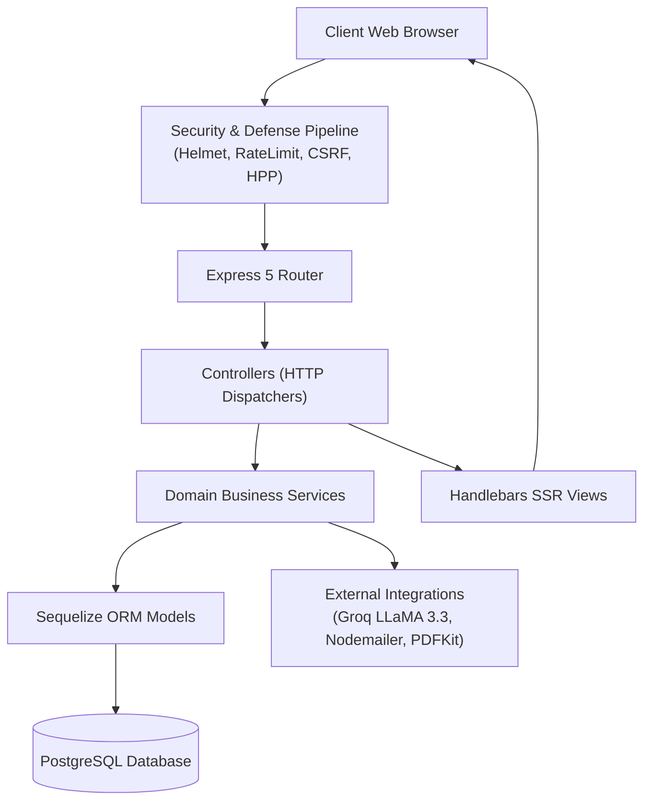
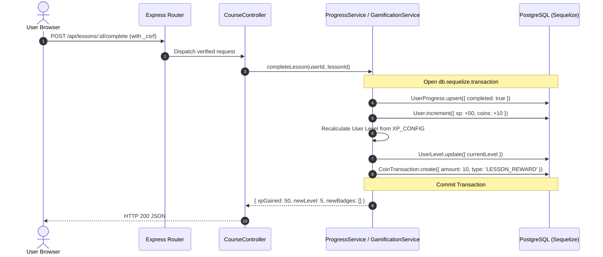
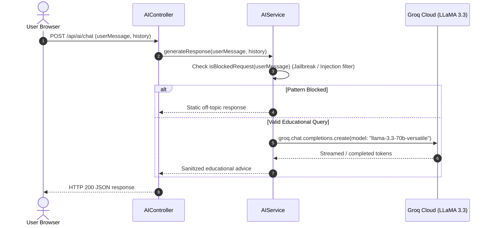

# TechIndustry — Agent Architecture Summary

This document provides a concise architectural mental model for AI coding agents and automated workflows working on the **TechIndustry** repository.

---

## 1. Top-Level Architectural Pattern

TechIndustry is designed as a **Modular Layered MVC Monolith**:

---

## 2. Directory Map & Responsibilities

| Directory | Role & Constraints |
|---|---|
| `src/config/` | Database (`database.js`), security, and third-party configuration bindings. |
| `src/controllers/` | Request unpacking, DTO validation, view rendering, or JSON response dispatch. **No direct business logic or DB calls.** |
| `src/services/` | Core domain operations: `gamificationService`, `aiService`, `authService`, `courseService`, `progressService`, `shopService`, `certificateService`. All transactions live here. |
| `src/models/` | Sequelize model declarations, relations, and hooks (`User`, `Course`, `Module`, `Lesson`, `CoinTransaction`, etc.). |
| `src/middleware/` | Auth checks (`isAuthenticated`, `isAdmin`), CSRF, rate limiters, validation middlewares. |
| `src/helpers/` | Handlebars view helper functions (`eq`, `formatDate`, `levelProgress`, etc.). |
| `src/views/` | Handlebars templates (`.hbs`), partials (`partials/`), and master layouts (`layouts/`). |
| `content/courses/` | Markdown course curriculum lessons and structured syllabi. |
| `public/` & `assets/` | Static CSS, JS, fonts (Inter-Bold, Inter-Regular), and imagery. |

---

## 3. Critical Runtime Flows

### 1. Course Progression & Gamification Flow

### 2. AI Mentor Query Flow

