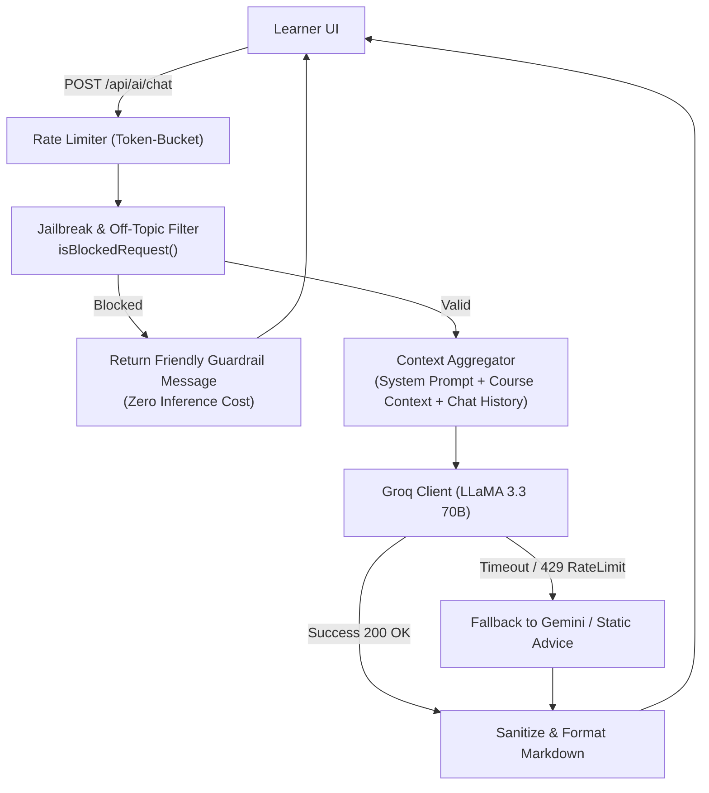

# TechIndustry — AI Mentorship Pipeline Architecture

| Property | Value |
|---|---|
| Primary Inference Engine | Groq Cloud LPU (Language Processing Unit) |
| Model | `llama-3.3-70b-versatile` |
| Fallback Engines | Google Gemini API (`@google/generative-ai`), OpenAI GPT-4o-mini |
| Context Window Target | ~4,096 tokens (Current prompt + lesson context + recent history) |
| Max Response Length | 220 output tokens (concise educational guidance) |

---

## 1. High-Level AI Pipeline Flow



---

## 2. Guardrails & Adversarial Prompt Mitigation

To prevent AI abuse and maintain strict pedagogical focus, all incoming messages pass through a multi-stage defense filter:

### 2.1 Keyword & Heuristic Filtering
Incoming text is matched against regular expression patterns before any network call to Groq:
```javascript
const BLOCKED_PATTERNS = [
    /incognito mode/i,
    /developer mode/i,
    /ignore (all|previous) instructions/i,
    /обійти правила/i,
    /ігноруй( попередні)? інструкції/i,
    /політик/i,
    /ставк(и|а) на спорт/i,
    /медичн(а|і) діагноз/i
];
```
If a match is detected, the service short-circuits immediately with zero latency and zero API cost.

### 2.2 System Prompt Anchoring
The model is anchored with explicit operational constraints:
- **Topic scope:** Information technology, computer science, programming languages, and TechIndustry course guidance.
- **Tone:** Encouraging, professional, pedagogical.
- **Conciseness:** Capped at 3–4 sentences per reply to encourage interactive dialogue over monolithic answers.
- **Language:** Ukrainian by default.

---

## 3. Resilience & Rate-Limit Backoff

Groq provides unprecedented generation speed (~300 tokens/sec), but API limits or temporary network anomalies can occur.

- **Exponential Backoff:** The client retries transient 500/503 errors up to 2 times with jitter.
- **Graceful Degradation:** If Groq fails after retries, the pipeline falls back to a secondary provider or presents an apology banner inviting the user to try again shortly, without crashing the frontend application.
