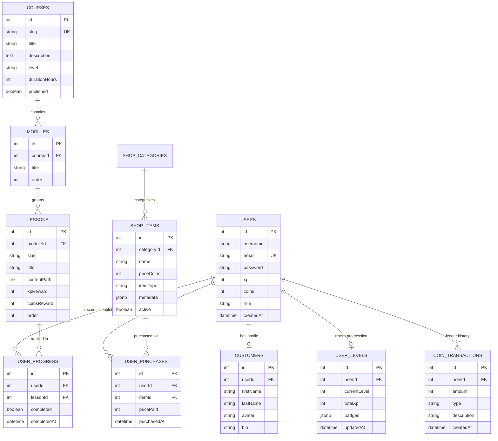

# TechIndustry — Relational Data Model & Database Architecture

| Metadata | Specification |
|---|---|
| Target Database | PostgreSQL 14+ |
| ORM | Sequelize 6.37.x |
| Schema Strategy | Normalized Relational (3NF) with JSONB flexibility |
| Transaction Isolation | Read Committed (default) / Serializable for Coin Mutations |

---

## 1. Entity-Relationship Overview

---

## 2. Model Specifications & Constraints

### 2.1 Users & Identity
- **`Users`**: Primary authentication entity. Passwords hashed using `bcrypt` (12 salt rounds).
- **`Customers`**: Extended user profile. Contains personal presentation data, customizable titles, and social handles.
- **`UserLevels`**: Stores pre-computed level status, total XP, and an array of unlocked badge identifiers stored in a `JSONB` column for fast array lookups without joining a separate badge join table for simple read operations.

### 2.2 Curricula Hierarchy
- **`Courses` $\rightarrow$ `Modules` $\rightarrow$ `Lessons`**:
  - `Courses.slug` is indexed uniquely for human-readable and SEO-friendly URLs (`/courses/csharp-dotnet`).
  - `Lessons.order` and `Modules.order` enforce linear or semi-linear pedagogical progression.
- **`UserProgress`**:
  - Unique composite index on `(userId, lessonId)`.
  - Upsert pattern used when marking lessons complete to prevent duplicate record insertion.

### 2.3 Financial & Gamification Ledger
- **`CoinTransactions`**:
  - Append-only financial ledger.
  - Every coin movement (positive for rewards, negative for shop purchases) generates an immutable record.
  - Summing `CoinTransactions` for a given `userId` matches the balance stored on `Users.coins`, serving as an audit trail against race conditions and tampering.

---

## 3. Transaction Management & Concurrency Control

When purchasing items from the shop or completing milestone courses:
1. An explicit managed transaction is acquired: `await db.sequelize.transaction(...)`.
2. A row-level lock (`SELECT ... FOR UPDATE`) is optionally placed on the user row if high contention is expected.
3. User coin balance is verified (`user.coins >= item.priceCoins`).
4. User balance is decremented, `UserPurchase` is inserted, and a `CoinTransaction` is logged atomically.
5. If any step fails, the transaction automatically rolls back, guaranteeing zero currency leakage.

---

## 4. Indexing & Query Optimization Strategy

| Table | Index Columns | Type | Purpose |
|---|---|---|---|
| `Users` | `email` | UNIQUE B-Tree | O(1) login lookup. |
| `Courses` | `slug` | UNIQUE B-Tree | Course detail route dispatch. |
| `UserProgress` | `(userId, lessonId)` | UNIQUE Composite | Prevents double completions; fast check for lesson access. |
| `UserProgress` | `(userId, completed)` | Composite B-Tree | Rapid progress bar and certificate eligibility calculations. |
| `CoinTransactions` | `userId, createdAt` | Composite B-Tree | Paginated ledger history for user profile. |
| `UserLevels` | `totalXp DESC` | B-Tree | High-speed global leaderboard ranking. |
