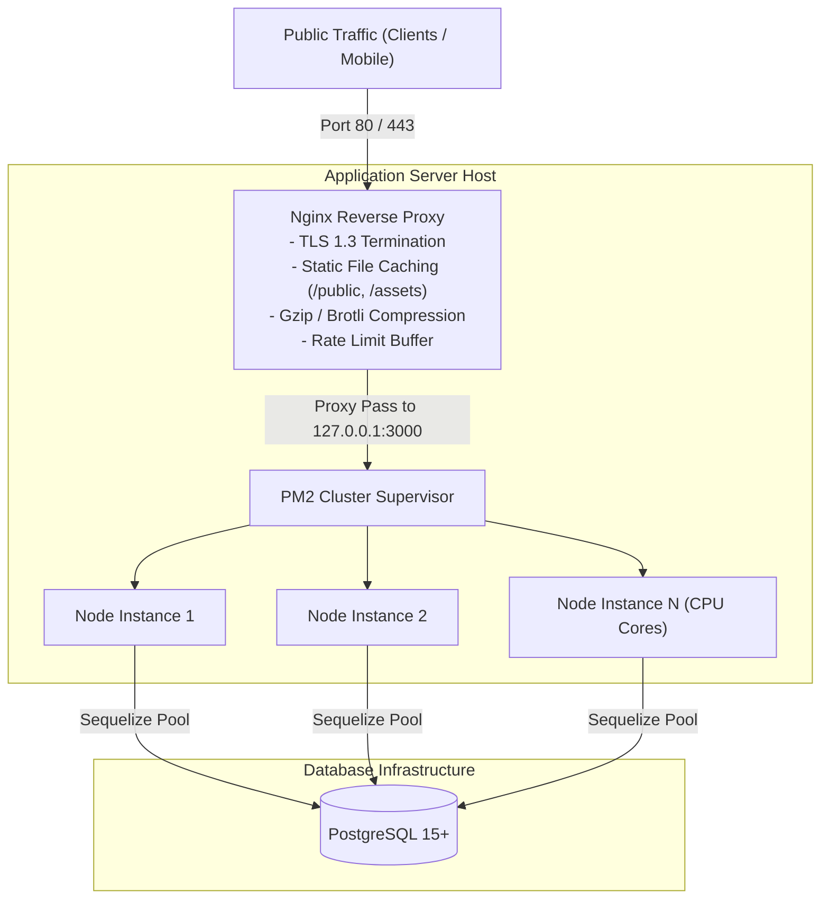

# TechIndustry — Deployment & Operations Guide

| Target Platform | Linux (Ubuntu 22.04 LTS / 24.04 LTS) |
|---|---|
| Process Supervisor | PM2 (Cluster Mode) or Docker Compose |
| Reverse Proxy | Nginx with Certbot (Let's Encrypt SSL/TLS) |
| Database Engine | PostgreSQL 15+ Managed or Self-Hosted |
| Caching & Queue | Redis (Optional / Planned Milestone 2) |

---

## 1. Production Topology



---

## 2. Nginx Configuration (Sample Virtual Host)

```nginx
server {
    listen 80;
    server_name techindustry.ua www.techindustry.ua;
    return 301 https://$host$request_uri;
}

server {
    listen 443 ssl http2;
    server_name techindustry.ua www.techindustry.ua;

    ssl_certificate /etc/letsencrypt/live/techindustry.ua/fullchain.pem;
    ssl_certificate_key /etc/letsencrypt/live/techindustry.ua/privkey.pem;
    ssl_protocols TLSv1.2 TLSv1.3;
    ssl_ciphers HIGH:!aNULL:!MD5;

    # Static Asset Offloading
    location /public/ {
        alias /var/www/techindustry/public/;
        expires 30d;
        add_header Cache-Control "public, no-transform";
    }

    location / {
        proxy_pass http://127.0.0.1:3000;
        proxy_http_version 1.1;
        proxy_set_header Upgrade $http_upgrade;
        proxy_set_header Connection 'upgrade';
        proxy_set_header Host $host;
        proxy_set_header X-Real-IP $remote_addr;
        proxy_set_header X-Forwarded-For $proxy_add_x_forwarded_for;
        proxy_set_header X-Forwarded-Proto $scheme;
        proxy_cache_bypass $http_upgrade;
    }
}
```

---

## 3. PM2 Process Management

In production, run the application using PM2 with an `ecosystem.config.js`:

```javascript
module.exports = {
  apps: [{
    name: "tech-industry",
    script: "./server.js",
    instances: "max",
    exec_mode: "cluster",
    env: {
      NODE_ENV: "production",
      PORT: 3000
    },
    max_memory_restart: "800M"
  }]
};
```

Commands:
```bash
pm2 start ecosystem.config.js
pm2 save
pm2 startup
```

---

## 4. PostgreSQL Database Maintenance & Tuning

### 4.1 Connection Pool Settings (`src/config/database.js`)
Ensure the pool size is aligned with your available CPU and PostgreSQL `max_connections`:
```javascript
pool: {
  max: 20,
  min: 5,
  acquire: 30000,
  idle: 10000
}
```

### 4.2 Automated Nightly Backup Cron:
```bash
# Nightly compressed PostgreSQL dump at 02:00 AM
0 2 * * * pg_dump -U tech_user -h localhost -d tech_industry_prod | gzip > /backups/db/tech_prod_$(date +\%Y\%m\%d).sql.gz
```
