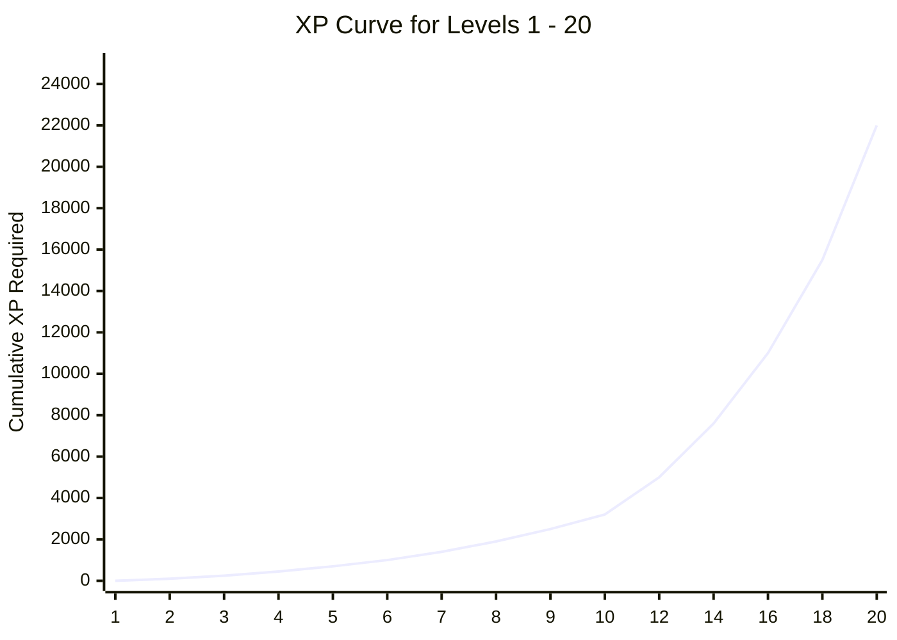

# TechIndustry — Gamification Economy & Progression Engine

| Specification | Details |
|---|---|
| Target Modules | `gamificationService.js`, `leaderboardService.js`, `shopService.js` |
| Economy Type | Dual Currency / Experience Ledger (XP + Virtual Coins) |
| Max Algorithmic Level | Level 1,000 |
| Concurrency Model | ACID Row Locks / Managed Sequelize Transactions |

---

## 1. Mathematical Mechanics & Formulas

The platform utilizes a hybrid progression curve designed to deliver early dopamine hits to newcomers while presenting rigorous long-term aspirational milestones for advanced students.

### 1.1 XP Reward Matrix
```text
Lesson Completion:      +50 XP
Quiz Pass:             +100 XP
Quiz Perfect (100%):   +150 XP
First Course Complete: +200 XP (Bonus)
Course Completion:     +500 XP
```

### 1.2 Level Thresholds Algorithm
Levels 1 through 1,000 are determined using an escalating threshold table (`LEVEL_THRESHOLDS`).

- **Early Levels (1–10):** Scaled quadratically ($100, 250, 450, 700, 1000, 1400, ...$).
- **Mid Levels (11–50):** Linear-quadratic blend designed for consistent weekly progression ($4000 \rightarrow 53500$).
- **Endgame Levels (50–1000):** Scaled up to $2,403,500$ cumulative XP for the prestigious **"Абсолютний Розум"** (Level 1,000).



---

## 2. Streak Maintenance & Timezone Handling

- **Activity Window:** A streak requires at least one completed lesson or quiz within a 24-hour UTC calendar boundary.
- **Freeze Mechanic:** If a user misses a day, streaks reset to zero unless a "Streak Freeze" item (purchased in the Shop) is present in their inventory.
- **Evaluation Timing:** Streaks are evaluated atomically upon `completeLesson` or `submitQuiz` triggers.

---

## 3. Virtual Coins & Ledger Accounting

Virtual coins power the platform's personalization economy (profile frames, titles, badges, streak freezes).

### Coin Award Rates:
- **Lesson Complete:** $+10\text{ coins}$
- **Quiz Pass:** $+30\text{ coins}$
- **Course Complete:** $+200\text{ coins}$

### Financial Invariants:
1. **Zero Double-Spending:**
   Purchases run inside managed transactions with `SELECT ... FOR UPDATE` isolation to prevent race condition exploits where multiple requests attempt to spend the same coin balance simultaneously.
2. **Immutable Audit Ledger:**
   Every coin credit or debit writes a corresponding record to `CoinTransactions` with category, amount, user ID, and timestamp.

---

## 4. Leaderboard Ranking Engine

The leaderboard service tracks:
- **Global All-Time:** Calculated based on `UserLevels.totalXp DESC`.
- **Weekly Sprint:** Filtered by user progress timestamps recorded within the last 7 calendar days.
- **Optimization Strategy:**
  - Database queries use composite indexing on `(totalXp DESC, id ASC)`.
  - Pagination uses keyset/cursor pagination to maintain sub-10ms response times even as the user base expands.
